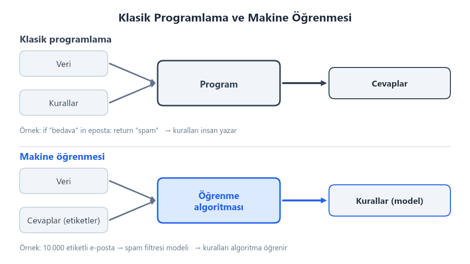
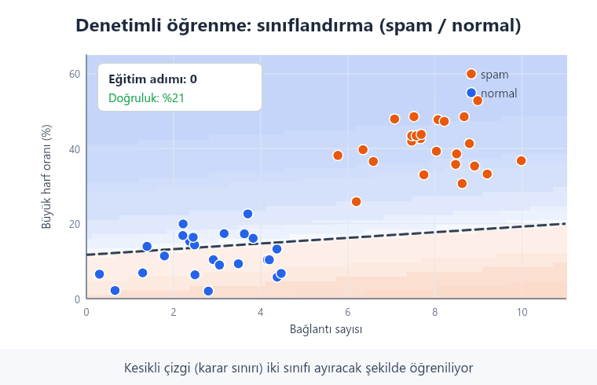
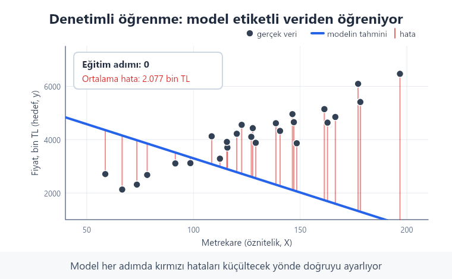
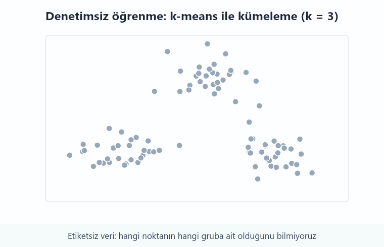
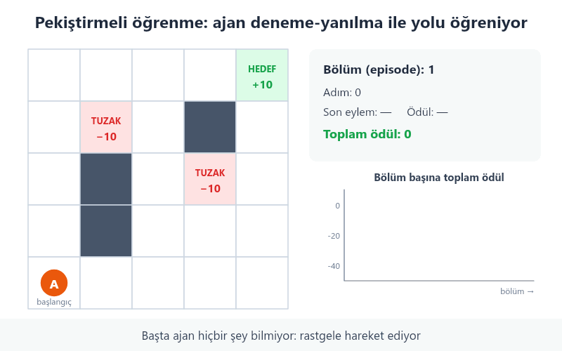
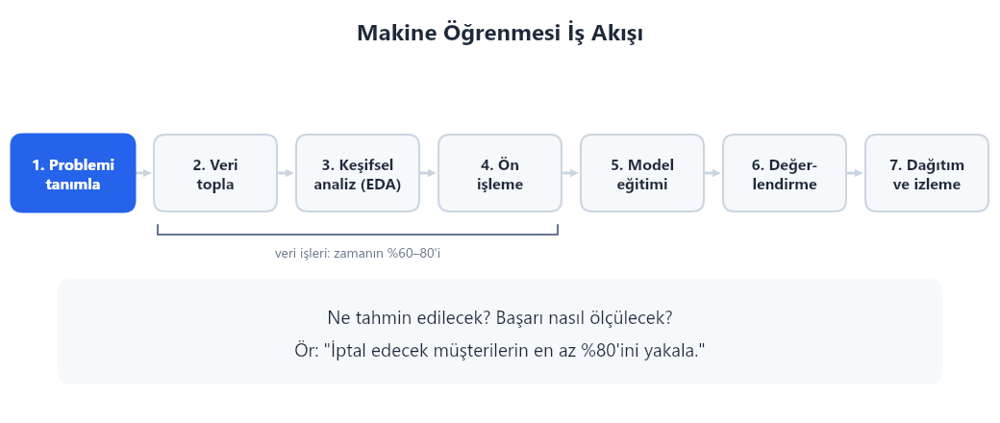

# Hafta 1 — Makine Öğrenmesine Giriş

## Bu haftanın sonunda

Bu notu bitirdiğinizde:

- Makine öğrenmesinin ne olduğunu kendi cümlelerinizle açıklayabilirsiniz.
- Denetimli, denetimsiz ve pekiştirmeli öğrenmeyi birbirinden ayırabilirsiniz.
- Bir makine öğrenmesi probleminde veri, öznitelik, hedef ve modelin ne olduğunu tanıyabilirsiniz.
- Basit bir sınıflandırma modelinin nasıl eğitilip denendiğini görebilirsiniz.

## Makine öğrenmesi nedir?

Klasik programlamada, bilgisayara hangi adımları izleyeceğimizi biz söyleriz. Bilgisayar bu kuralları kullanarak bir sonuç üretir.

Makine öğrenmesinde ise bilgisayara çok sayıda örnek gösteririz. Bilgisayar bu örneklerdeki ilişkileri bulur ve yeni örnekler için tahmin yapmayı öğrenir.

**Tanım:** Makine öğrenmesi, bilgisayarın örnek verilerden örüntüler öğrenerek yeni veriler hakkında tahmin veya karar vermesini sağlayan yöntemler bütünüdür. Her kuralı tek tek yazmak yerine, bilgisayara örnekler üzerinden öğrenme olanağı veririz.

Örneğin, klasik bir spam filtresinde “mesajda şu kelime varsa spam say” gibi kurallar yazabiliriz. Makine öğrenmesi yaklaşımında ise daha önce spam ve normal olarak etiketlenmiş mesajları modele veririz. Model, mesajlardaki örüntüleri öğrenerek yeni bir mesajın hangi gruba daha çok benzediğini tahmin eder.



Makine öğrenmesi her problem için en iyi çözüm değildir. Sorunu açık kurallarla çözebiliyorsak klasik programlama daha basit ve güvenilir olabilir. Öğrenilecek yeterli örnek yoksa veya tahminin nedenini açıklamak gerekiyorsa makine öğrenmesini kullanmadan önce dikkatlice düşünmeliyiz.

## Önemli kavramlar

Bir makine öğrenmesi çalışmasında sıkça şu kelimeler kullanılır:

- **Örnek:** Veri içindeki tek bir kayıt. Örneğin, bir müşterinin alışveriş bilgileri.
- **Öznitelik:** Örnek hakkında kullandığımız bilgi. Bir ev için oda sayısı ve metrekaresi öznitelik olabilir.
- **Hedef:** Tahmin etmek istediğimiz sonuç. Örneğin, evin satış fiyatı.
- **Model:** Verideki ilişkileri öğrenen ve tahmin üreten yöntem.
- **Eğitim:** Modelin örneklerden ilişki öğrenmesi.
- **Tahmin:** Eğitilmiş modelin daha önce görmediği bir örnek için sonuç üretmesi.

Bir evin satış fiyatını tahmin ederken oda sayısı ve metrekare öznitelik, satış fiyatı ise hedef olur. Hedef, problemde neyi tahmin etmek istediğimize göre değişir.

Makine öğrenmesi şu üç parçayla da tanımlanabilir:

1. **Görev:** Modelin yapması beklenen iş.
2. **Başarı ölçüsü:** Modelin işini ne kadar iyi yaptığını gösteren ölçü.
3. **Deneyim:** Modelin öğrenmek için kullandığı örnekler.

Bir spam filtresinde görev mesajları sınıflandırmak, başarı ölçüsü doğru sınıflandırılan mesajların oranı, deneyim ise önceden etiketlenmiş mesajlardır.

## Makine öğrenmesi türleri

### Denetimli öğrenme

Denetimli öğrenmede örneklerin doğru cevapları eğitim sırasında bilinir. Model, verilen bilgilerden bu cevapları tahmin etmeyi öğrenir.

- **Sınıflandırma:** Sonuç bir sınıftır. Örnek: e-postanın “spam” veya “normal” olması.
- **Regresyon:** Sonuç sayısal bir değerdir. Örnek: bir evin fiyatının tahmini.





### Denetimsiz öğrenme

Denetimsiz öğrenmede doğru cevaplar verilmez. Model, verideki benzerlikleri veya yapıları bulmaya çalışır. Örneğin, müşterileri benzer alışveriş alışkanlıklarına göre gruplamak bir kümeleme problemidir.



### Pekiştirmeli öğrenme

Pekiştirmeli öğrenmede bir **ajan**, bir ortamda eylemler yapar. İyi sonuçlar ödül, istenmeyen sonuçlar ise ceza ile gösterilir. Ajan zamanla daha iyi kararlar almaya çalışır. Bir oyunda puan kazanmayı öğrenen program buna örnektir.



## Makine öğrenmesi iş akışı

Bir model eğitmek, çalışmanın yalnızca bir parçasıdır. Genel iş akışı şöyledir:

1. **Problemi tanımlayın:** Hangi kararı veya tahmini yapmak istiyoruz?
2. **Veriyi toplayıp anlayın:** Her satırın ve sütunun ne anlama geldiğini öğrenin.
3. **Veriyi hazırlayın:** Eksik ve hatalı değerleri inceleyin; veriyi modele uygun hale getirin.
4. **Veriyi ayırın:** Modeli eğitmek ve daha sonra denemek için farklı örnekler kullanın.
5. **Modeli eğitin:** Eğitim verisindeki örneklerden ilişkileri öğrenmesini sağlayın.
6. **Modeli değerlendirin:** Daha önce görmediği verilerde ne kadar iyi çalıştığını ölçün.
7. **Sonuçları gözden geçirin:** Hataların türünü inceleyin ve gerekiyorsa önceki adımları iyileştirin.



Modeli eğitmek için kullanılan veriyi değerlendirmede de kullanmak, gerçek başarısını olduğundan iyi gösterebilir. Bu nedenle veriyi ayırmak önemlidir. Veri ayırma ve veri sızıntısı konusunu 2. haftada ayrıntılı inceleyeceğiz.

## İlk model: Iris çiçeği sınıflandırması

Iris veri setinde çiçeklerin taç ve çanak yaprak ölçüleri ile çiçek türü bulunur. Aşağıdaki örnek, ölçülerden çiçek türünü tahmin eden basit bir k-en yakın komşu (k-NN) modeli kurar.

```python
from sklearn.datasets import load_iris
from sklearn.model_selection import train_test_split
from sklearn.neighbors import KNeighborsClassifier
from sklearn.metrics import accuracy_score

iris = load_iris()
X = iris.data
y = iris.target

X_train, X_test, y_train, y_test = train_test_split(
    X, y, test_size=0.25, random_state=42, stratify=y
)

model = KNeighborsClassifier(n_neighbors=3)
model.fit(X_train, y_train)

predictions = model.predict(X_test)
print("Doğruluk:", accuracy_score(y_test, predictions))
```

`X` öznitelikleri, `y` ise tahmin etmek istediğimiz çiçek türünü tutar. Veriyi eğitim ve test parçalarına ayırdıktan sonra model yalnızca eğitim parçasıyla öğrenir. Test parçası, modelin daha önce görmediği örneklerdeki başarısını ölçmek için kullanılır. `random_state`, veri ayırma işleminin tekrar çalıştırıldığında aynı sonucu vermesine yardımcı olur. `stratify=y`, her çiçek türünün iki parçada da benzer oranda bulunmasını sağlar.

`accuracy_score` doğru tahminlerin oranını verir. Bu örnek, bir modelin tüm performansını açıklamaz; yalnızca ilk ve kolay anlaşılır bir ölçüdür. Daha sonra farklı değerlendirme ölçülerini öğreneceğiz.

## Python araçlarına kısa bakış

Veriyle çalışırken NumPy sayısal diziler, pandas ise satır ve sütunlardan oluşan tablolar için kullanılır.

```python
import numpy as np
import pandas as pd

olcumler = np.array([10, 20, 30])
print(olcumler * 2)

tablo = pd.DataFrame({
    "sehir": ["Ankara", "İzmir", "Ankara"],
    "sicaklik": [18, 24, 20],
})
print(tablo[tablo["sehir"] == "Ankara"])
```

NumPy dizisindeki her değer ikiyle çarpılır. pandas örneğinde ise tablo, `sehir` değeri Ankara olan satırlara göre süzülür. Bu araçlar veriyi incelememize ve hazırlamamıza yardım eder; tek başlarına makine öğrenmesi modeli değildir.

## Kısa özet

- Makine öğrenmesi, örneklerden yararlanarak tahmin veya karar üretmeyi öğrenir.
- Öznitelikler modele verilen bilgiler, hedef ise tahmin edilmek istenen sonuçtur.
- Denetimli öğrenmede doğru cevaplar vardır; denetimsiz öğrenmede gruplar veya yapılar aranır; pekiştirmeli öğrenmede ajan ödül ve ceza ile öğrenir.
- Model eğitimi kadar, daha önce görmediği verilerde doğru değerlendirilmesi de önemlidir.

## Kendinizi sınayın

1. Bir evin satış fiyatını tahmin ederken hedef ve iki olası öznitelik ne olabilir?
2. Müşterileri alışveriş alışkanlıklarına göre gruplamak hangi öğrenme türüne girer?
3. Spam mesajı bulmak sınıflandırma mı, regresyon mu?
4. Modelin daha önce görmediği verilerle değerlendirilmesi neden önemlidir?

## Uygulama

1. Yukarıdaki Iris kodunu çalıştırın. Doğruluk değeri ne anlama geliyor?
2. `n_neighbors` değerini 1 ve 7 yaparak sonucu karşılaştırın. Sonuçların değişmesi size ne anlatıyor?
3. Iris örneğinde özniteliklerin ve hedefin adlarını inceleyin. `X` içindeki bir satır hangi bilgileri temsil ediyor?
