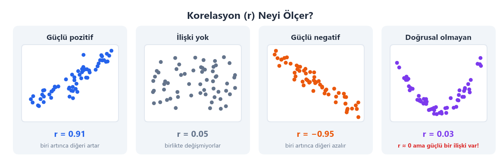
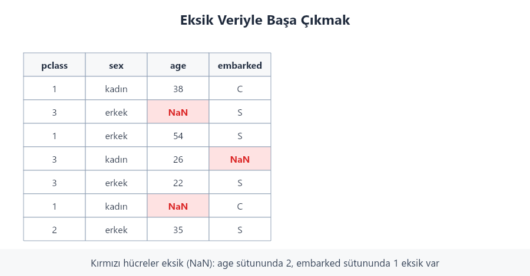
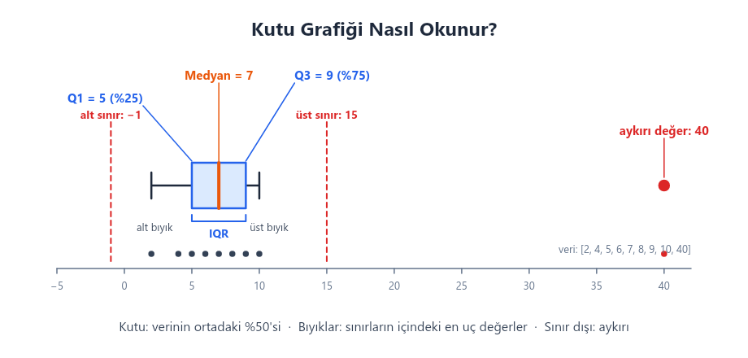
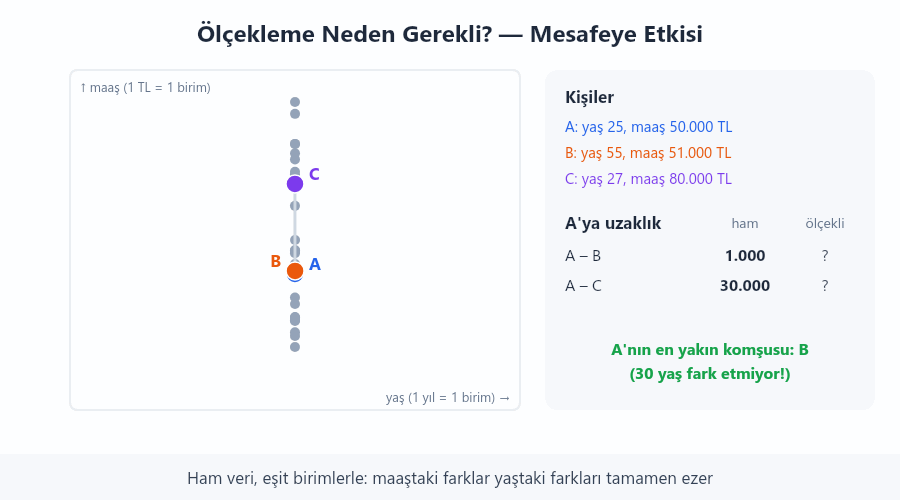
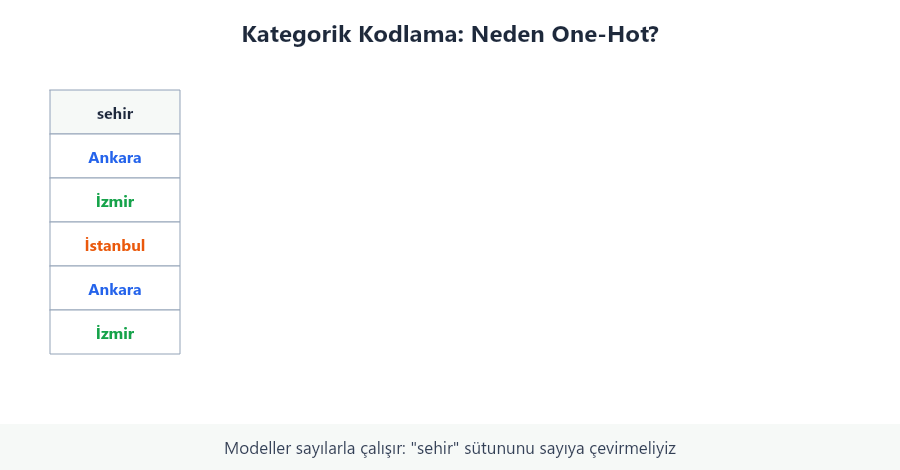
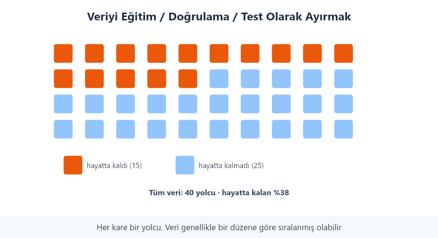
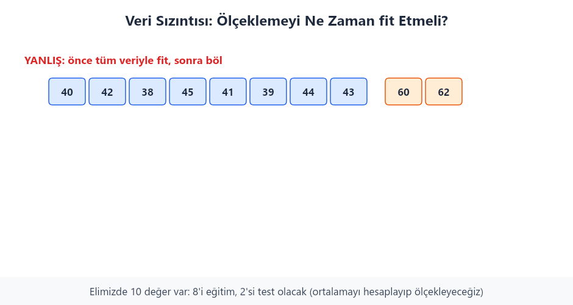

# Hafta 2 — Veri Hazırlama ve Keşifsel Veri Analizi

## Bu haftanın sonunda

Bu notu bitirdiğinizde:

- Bir veri setindeki sütunları ve değerleri sistemli biçimde inceleyebilirsiniz.
- Eksik ve aykırı değerleri fark edip olası çözümleri tartışabilirsiniz.
- Sayısal ve kategorik verileri modele uygun hale getirmenin temel yollarını tanıyabilirsiniz.
- Veriyi eğitim ve test parçalarına ayırmanın ve veri sızıntısından kaçınmanın neden önemli olduğunu açıklayabilirsiniz.

## Veriyi tanımak

Bir model kurmadan önce elimizdeki veriyi anlamalıyız. **Keşifsel veri analizi** (EDA), verinin nasıl göründüğünü ve hangi sorunları içerdiğini inceleme sürecidir.

İlk olarak şu soruları sorun:

- Her satır neyi temsil ediyor?
- Sütunların anlamı ve ölçü birimi nedir?
- Sayısal ve kategorik sütunlar hangileridir?
- Eksik değer var mı? Hangi sütunlarda ve ne kadar?
- Beklenmeyen, yinelenen veya hatalı kayıtlar var mı?
- Tahmin etmek istediğimiz hedef sütun nedir?

### Tek bir değişkeni inceleme

Tek bir sütunun dağılımına bakmak, sık görülen değerleri, yayılımı ve uç değerleri anlamaya yardım eder. Sayısal sütunlar için ortalama, ortanca, en küçük ve en büyük değerler incelenebilir. Kategorik sütunlarda her grubun kaç kez görüldüğüne bakılabilir.

### Değişkenler arasındaki ilişki

İki sütunu karşılaştırmak, aralarında bir ilişki olup olmadığına dair ipucu verebilir. Örneğin, evin metrekaresi arttıkça fiyatın da artıp artmadığına bakabiliriz. Korelasyon, iki sayısal değişkenin doğrusal biçimde birlikte değişip değişmediğini özetler. Korelasyon tek başına bir değişkenin diğerine **neden olduğunu** göstermez.



Korelasyon katsayısı `-1` ile `1` arasındadır. `1` güçlü pozitif doğrusal ilişkiyi, `-1` güçlü negatif doğrusal ilişkiyi, `0` ise doğrusal ilişkinin zayıf veya görünür olmadığını gösterir. Bu değer, eğrisel ilişkileri açıklamayabilir ve aykırı değerlerden etkilenebilir.

## Eksik değerler

Bir bilgi veri setinde bulunmuyorsa bu durumu eksik değer olarak görürüz. Önce eksik değerlerin sayısını ve hangi satırlarda bulunduğunu inceleyin. Sonra neden eksik olduklarını ve eksikliğin ne anlama geldiğini düşünün.

Eksikliklerin nasıl oluştuğunu anlamak için üç yaygın ad kullanılır:

- **MCAR:** Eksikliğin oluşması, verideki diğer bilgilerle ilişkili görünmez.  
**Analoji**: Bir sınıftaki öğrencilerin anket kâğıtlarını düşünün. Fotokopi makinesi bazı kâğıtların bir bölümünü rastgele silmiş olsun. Silinen cevapların hangi öğrenciye ait olduğu; öğrencinin yaşı, notu veya verdiği cevaplarla ilgili değildir. Bu durumda eksiklik rastlantısaldır.
- **MAR:** Eksiklik, veri setinde gördüğümüz başka bir bilgiyle ilişkili olabilir.  
**Analoji**:Bir ankette kişilerin yaşı ve aylık geliri soruluyor. Genç katılımcılar gelir sorusunu daha sık boş bırakıyor olsun. Yaş bilgisi ankette mevcut olduğu için, gelirdeki eksikliğin bildiğimiz yaş bilgisiyle ilişkili olduğunu görebiliriz.
- **MNAR:** Eksiklik, eksik olan değerin kendisiyle ilişkili olabilir.  
**Analoji**: Bir ankette kişilere aylık gelirleri soruluyor. Geliri çok yüksek olan kişiler, gelirlerinin yüksek olması nedeniyle bu soruyu yanıtlamaktan daha sık kaçınıyor olsun. Geliri yüksek olanların cevabının daha çok eksik kalması, eksik değerin kendisiyle ilişkilidir. Bu duruma MNAR denir. Yani eksikliğin nedeni, yalnızca başka sütunlarda gördüğümüz bilgilerle açıklanamaz.

Bu türleri her zaman kesin olarak belirlemek mümkün değildir. Önemli olan, eksik değerleri düşünmeden silmemek veya doldurmamaktır. Bir sütunda eksiklerin çok az olması ve satırların başka açıdan da kullanılamaması halinde bazı satırları çıkarmak uygun olabilir. Aksi halde:

- Sayısal değerler ortalama veya ortanca ile doldurulabilir. Aykırı değer varsa ortanca çoğu zaman daha dayanıklıdır.
- Kategorik değerler en sık görülen kategoriyle veya açık bir “Bilinmiyor” değeriyle doldurulabilir.
- Eksikliğin kendisi önemliyse, değerin eksik olup olmadığını gösteren yeni bir sütun eklenebilir.



Bir doldurma yöntemini seçerken kullanım amacını ve verinin nasıl toplandığını dikkate alın. Örneğin, maaş bilgisi eksik olan kişilerin diğer kişilerden sistemli biçimde farklı olması mümkünse, yalnızca ortalama maaşla doldurmak yanıltıcı olabilir.

## Aykırı değerler

Aykırı değer, diğer değerlerden oldukça uzak görünen bir değerdir. Bu değer bir yazım hatası olabilir; ancak gerçek ve önemli bir olayı da gösterebilir. Bu nedenle aykırı değerleri bulduktan sonra hemen silmeyin. Önce kaynağını araştırın.

### IQR yöntemi

IQR, üçüncü çeyrek ile birinci çeyrek arasındaki farktır:

`IQR = Q3 - Q1`

IQR yönteminde şu aralığın dışındaki değerler aykırı adayları olarak işaretlenir:

- Alt sınır: `Q1 - 1.5 × IQR`
- Üst sınır: `Q3 + 1.5 × IQR`

Bu sınır, bir değerin kesinlikle yanlış olduğunu söylemez; yalnızca incelemek için işaretler.



Grafikteki küçük veri kümesi şöyledir:

`[2, 4, 5, 6, 7, 8, 9, 10, 40]`

Veriler küçükten büyüğe sıralıdır. Önce ortadaki değeri, yani **ikinci çeyreği (Q2)** buluruz. Sonra Q2'yi alt ve üst grupları belirlemek için kullanırız. Bu görselde ortanca, iki gruba da dahil edilmiştir:

- **Q2 (ortanca):** Dokuz değer olduğundan ortadaki, yani beşinci değer ortancadır: `Q2 = 7`.
- **Q1 (alt çeyrek):** Alt grup `[2, 4, 5, 6, 7]` olur. Bu grubun ortadaki değeri `5` olduğundan `Q1 = 5`.
- **Q3 (üst çeyrek):** Üst grup `[7, 8, 9, 10, 40]` olur. Bu grubun ortadaki değeri `9` olduğundan `Q3 = 9`.


Şimdi IQR'yi ve aykırı değer sınırlarını hesaplayalım:

1. `IQR = Q3 - Q1 = 9 - 5 = 4`. Kutu, Q1 ile Q3 arasındaki orta yüzde 50'lik bölümü gösterir.
2. Alt sınır: `Q1 - 1.5 × IQR = 5 - 1.5 × 4 = -1`.
3. Üst sınır: `Q3 + 1.5 × IQR = 9 + 1.5 × 4 = 15`.
4. `40`, üst sınır olan 15'ten büyük olduğu için aykırı değer adayıdır. Diğer değerler bu sınırların içindedir.

> Çeyrekleri hesaplamanın başka yöntemleri de vardır. Örneğin ortanca alt ve üst gruplara dahil edilmezse bu veri için `Q1 = 4.5` ve `Q3 = 9.5` bulunur. Yöntem değişince sonuçlar biraz değişebilir; önemli olan kullandığınız yöntemi belirtmek ve aynı hesap boyunca tutarlı kullanmaktır.

Grafikte bıyıklar, sınırlar içinde kalan en küçük ve en büyük değere kadar uzanır: bu örnekte 2 ve 10. Hesaplanan sınırlar bıyıkların uçları değildir; hangi değerlerin aykırı aday olarak işaretleneceğini belirler. **Aykırı değer adayı, kesinlikle hatalı değer demek değildir.** Örneğin 40 gerçek bir ölçüm olabilir; silmeden önce verinin kaynağını kontrol etmek gerekir.

### Z-skoru

Z-skoru, bir değerin ortalamadan kaç standart sapma uzakta olduğunu gösterir:

`z = (değer - ortalama) / standart sapma`

Mutlak Z-skorunun çok yüksek olması, değerin incelenmesini gerektirebilir. Bu yöntem ortalama ve standart sapmadan etkilendiği için, çok çarpık dağılımlarda veya aykırı değerlerin bulunduğu veride dikkatle kullanılmalıdır.

## Ölçekleme

Ölçekleme, sayısal sütunları benzer aralıklara getirir. Bazı yöntemler, örneğin k-NN, uzaklıklara baktığı için büyük sayılı bir sütun diğer sütunları baskılayabilir.

- **Standardizasyon:** Değerleri ortalaması yaklaşık `0`, standart sapması yaklaşık `1` olacak biçimde dönüştürür.
- **Min-max ölçekleme:** Değerleri çoğunlukla `0` ile `1` arasına taşır.
- **Robust ölçekleme:** Ortanca ve çeyrekleri kullanır; aykırı değerlerden daha az etkilenir.



Ölçekleme her model için gerekli değildir. Karar ağaçları genellikle değerlerin ölçeğine duyarlı değildir; k-NN ve doğrusal modeller ise ölçeklemeden yarar görebilir.

## Kategorik verileri sayılara çevirme

Birçok model metin kategorilerini doğrudan kullanamaz. Kategorilerin anlamını bozmadan uygun bir gösterime çevirmek gerekir.

- **Sıralı kodlama:** Doğal bir sıraya sahip kategorileri bu sırayı koruyan sayılara çeviririz. Örneğin, memnuniyet cevaplarını `memnun değilim = 1`, `kararsızım = 2`, `memnunum = 3` olarak kodlayabiliriz. Böylece model cevaplar arasındaki sıralamayı görür: `1 < 2 < 3`. Bu sayılar kategorilerin adıdır; `3` cevabı, `1` cevabının tam üç katı memnuniyet anlamına gelmez.
- **One-hot kodlama:** Sırası olmayan kategoriler için her kategoriye ayrı bir 0/1 sütunu açar. Örneğin, renkler “kırmızı”, “mavi” ve “yeşil” olarak verilmişse, bunlara `0` veya `1` değerleri atanır.

Sırası olmayan kategorilere gelişigüzel olarak `1, 2, 3` vermek, modelin bu sayılar arasında anlamlı bir büyüklük sırası olduğunu sanmasına neden olabilir.



## Eğitim ve test verisini ayırma

**Eğitim verisi**, modelin öğrenmesi için kullanılır. **Test verisi** ise eğitim sırasında kullanılmaz; modelin yeni örneklerdeki başarısını ölçmek için ayrılır. Model seçimi sırasında ayrıca bir **doğrulama verisi** kullanılabilir.

Sınıflandırma problemlerinde sınıfların oranı küçük veri parçalarında çok değişebilir. `stratify` seçeneği, sınıf oranlarını eğitim ve test parçalarında benzer tutmaya yardım eder. Zaman sıralı veride rastgele bölme gelecekteki bilgiyi geçmişe karıştırabilir; bu tür veriler zamana göre bölünmelidir.



## Veri sızıntısı

Veri sızıntısı, modelin eğitim sırasında gerçekte tahmin anında bilemeyeceği bilgiyi kullanmasıdır. Bu durumda test sonucu gerçekte elde edilebilecek başarıdan daha iyi görünür.

Sık görülen bir örnek, bütün veri üzerinde ortalama veya standart sapmayı hesaplayıp veriyi sonradan ayırmaktır. Bu hesaplama test verisinden bilgi alır. Doğru sıra şöyledir:

1. Veriyi eğitim ve test parçalarına ayırın.
2. Doldurma, ölçekleme ve kodlama gibi işlemleri eğitim verisinde öğrenin.
3. Öğrenilen işlemleri eğitim ve test verisine uygulayın.
4. Modeli eğitim verisinde eğitin; test verisini yalnızca son değerlendirme için kullanın.

Bir `Pipeline`, hazırlama adımlarının ve modelin birlikte çalışmasını sağlar. Böylece her eğitim aşamasında dönüşümler yalnızca o aşamanın eğitim parçasından öğrenilir.



## Titanic verisinde örnek çalışma

Aşağıdaki örnekte yolcunun yaşı ve bilet ücreti kullanılarak hayatta kalıp kalmadığı tahmin edilir. Kodun kısa ve anlaşılır olması için yalnızca bu iki sayısal özelliği kullanıyoruz. Titanic verisi `seaborn` ile yüklenir; ilk kullanımda internet bağlantısı gerekebilir.

```python
import seaborn as sns
from sklearn.impute import SimpleImputer
from sklearn.linear_model import LogisticRegression
from sklearn.metrics import accuracy_score
from sklearn.model_selection import train_test_split

veri = sns.load_dataset("titanic")
X = veri[["age", "fare"]]
y = veri["survived"]

X_egitim, X_test, y_egitim, y_test = train_test_split(
    X, y, test_size=0.2, random_state=42, stratify=y
)

tamamlayici = SimpleImputer(strategy="median")
X_egitim = tamamlayici.fit_transform(X_egitim)
X_test = tamamlayici.transform(X_test)

model = LogisticRegression(max_iter=1000)
model.fit(X_egitim, y_egitim)
tahmin = model.predict(X_test)
print("Test doğruluğu:", accuracy_score(y_test, tahmin))
```

Önce veri eğitim ve test parçalarına ayrılır. Eksik yaş değerleri, yalnızca eğitim verisindeki ortanca kullanılarak tamamlanır; öğrenilen aynı değer test verisine de uygulanır. Böylece test verisinden bilgi öğrenme işlemine sızmaz. Son olarak model eğitilir ve daha önce görmediği test verisindeki doğruluk oranı yazdırılır. Doğruluk, doğru tahminlerin oranıdır; tek başına modelin her yolcu grubu için eşit derecede iyi çalıştığını göstermez.

## Kısa özet

- Model kurmadan önce satırların ve sütunların ne anlama geldiğini öğrenin.
- Eksik ve aykırı değerleri inceleyin; doğrudan silmek yerine nedenlerini ve etkilerini düşünün.
- Sırasız kategoriler için one-hot kodlama, doğal sıralı kategoriler için sıralı kodlama kullanın.
- Ölçekleme bazı modeller için önemlidir, ancak her model için zorunlu değildir.
- Veriyi önce ayırın; hazırlama adımlarını yalnızca eğitim verisinden öğrenin.

## Kendinizi sınayın

1. Korelasyonun yüksek olması, bir sütunun diğerine neden olduğunu kanıtlar mı?
2. `küçük`, `orta`, `büyük` değerleri için hangi kodlama yöntemi uygundur? Peki `kırmızı`, `mavi`, `yeşil` için?
3. Aykırı görünen her değeri silmek neden hatalı olabilir?
4. Ölçekleyiciyi veri ayırmadan önce bütün veriyle eğitmek neden veri sızıntısına yol açar?
5. Zaman sıralı bir veri setinde rastgele eğitim-test ayırımı neden sorun çıkarabilir?

## Uygulama

1. Titanic verisinde `isna().sum()` çıktısını inceleyin. En çok eksik değeri olan sütun hangisidir?
2. `fare` sütununu bir histogram veya kutu grafiğiyle inceleyin. Aykırı değer adayları görüyor musunuz?
3. `sex` ve `class` sütunları için neden sayılara gelişigüzel `1, 2, 3` vermek yerine one-hot kodlama kullandığımızı açıklayın.
4. Örnek koddaki `test_size` değerini değiştirmeden önce, test verisi büyürse eğitim için ne olacağını tahmin edin.
